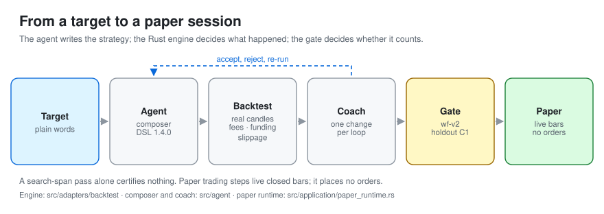
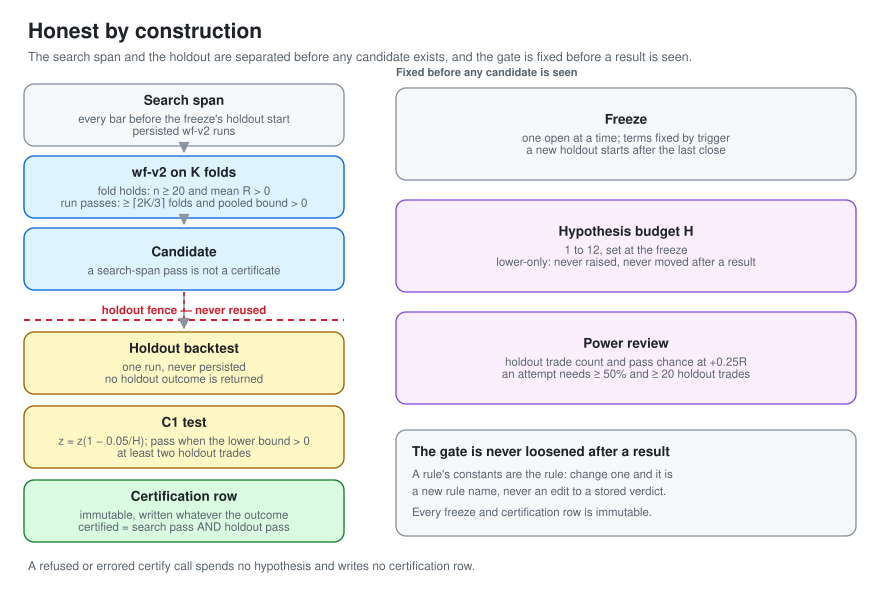
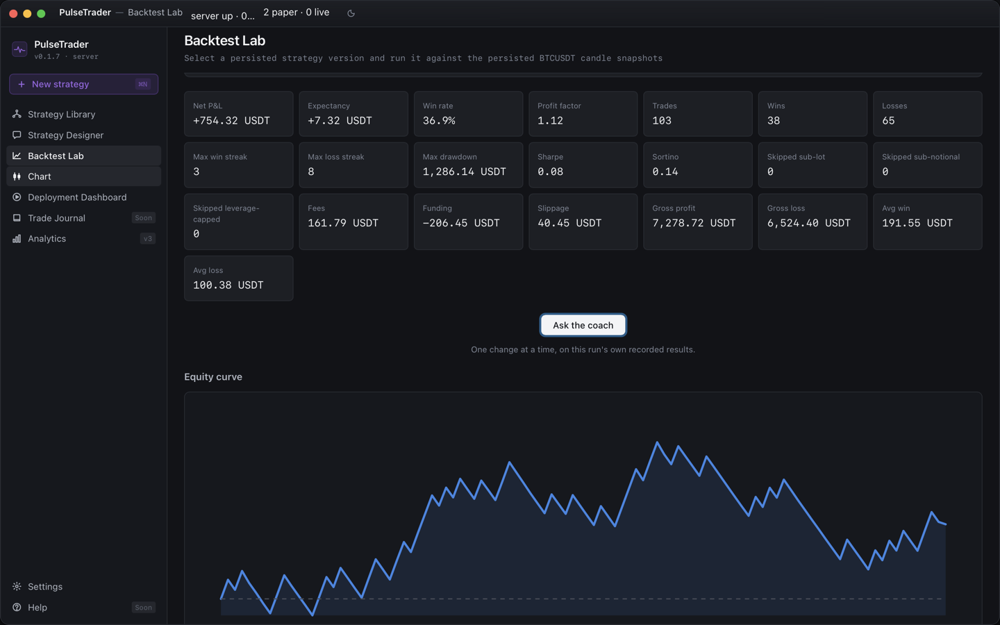
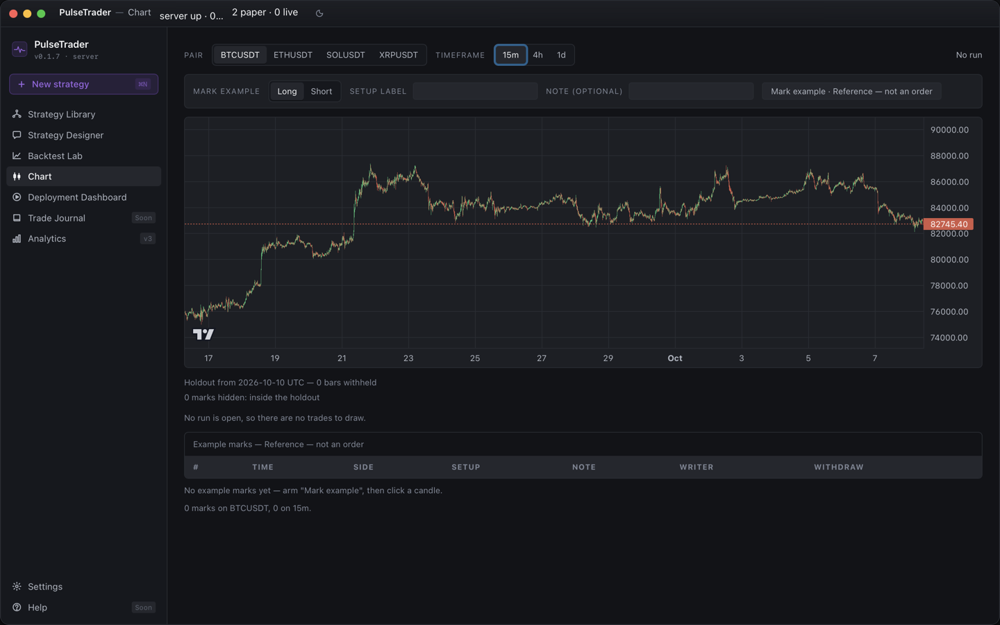
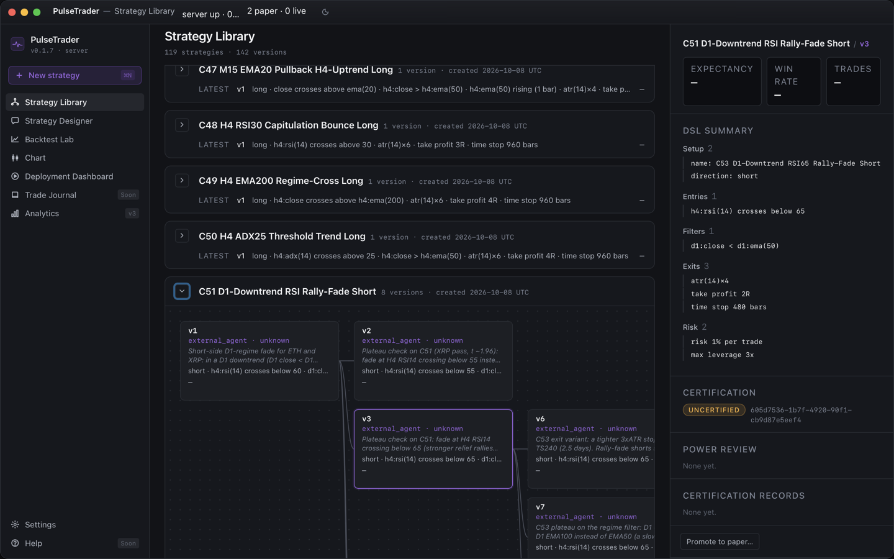
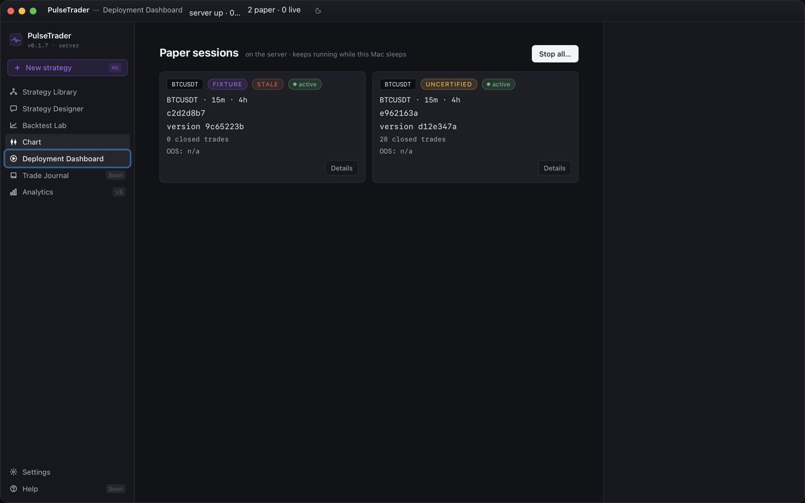
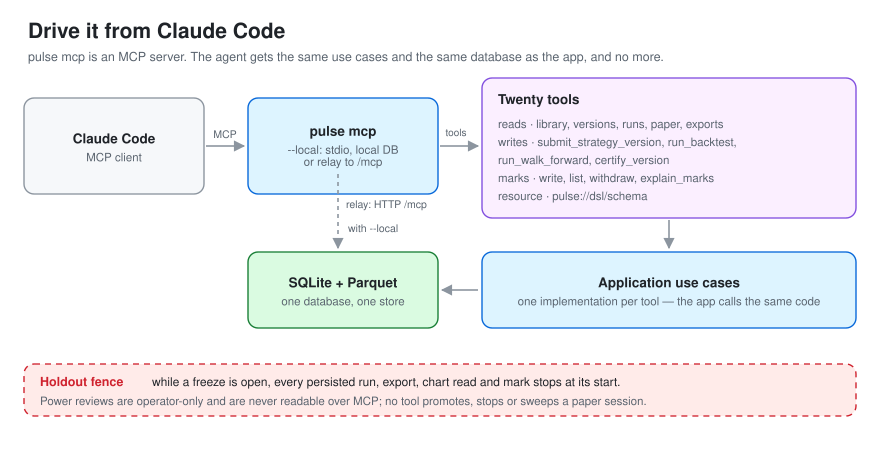
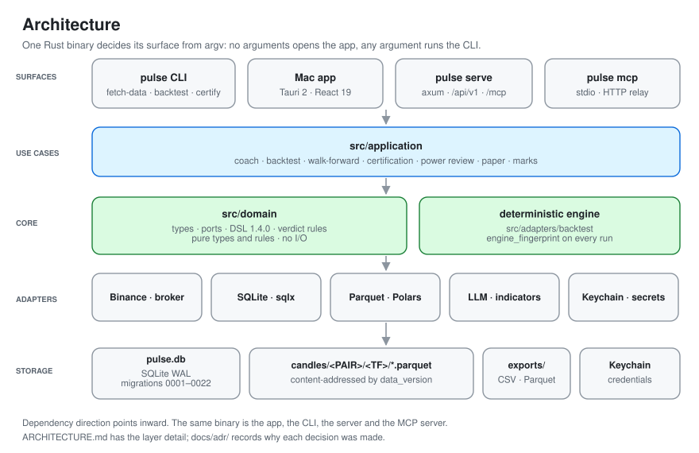
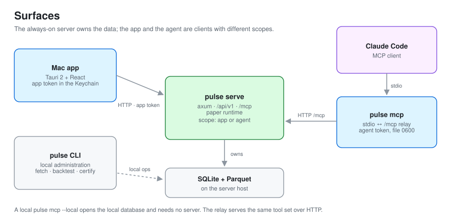

<p>
  
</p>

# PulseTrader

**Describe a strategy. Let the agent build it. Count it only when it survives data its search never saw.**

<p>
  
  
  
</p>

PulseTrader is a macOS app and a Rust engine for developing crypto-futures strategies with an AI
agent. You describe a target in plain words. The agent writes it in a small strategy DSL. The Rust
engine backtests it on real Binance USDT-M futures candles with fees, funding and slippage. A coach
proposes one change per loop.

A strategy under the real-data campaign gate counts only when walk-forward and a fenced holdout
agree — and both gates are fixed before you see the answer. The same engine is an MCP server, so
Claude Code can drive the loop directly.

[What it does](#what-it-does) · [Honest by construction](#honest-by-construction) · [Screens](#screens) · [Claude Code](#drive-it-from-claude-code) · [Quickstart](#quickstart) · [Architecture](#architecture) · [Status](#status-and-roadmap)

## What it does

1. **You describe a target.** In the app's Designer, or with `pulse compose "<target>"`: pair,
   direction, setup, stop, target — plain words.
2. **The agent writes the strategy.** The composer drives six validated builder tools and emits a
   DSL document (schema 1.4.0). The strategy is stored as that document; the engine never reads
   prose.
3. **The Rust engine backtests it.** Deterministic, on real Binance USDT-M candles fetched by
   `pulse fetch-data`. Every trade carries its fee (4 bp taker by default), its slippage (1 bp) and
   its funding. The run stores an `engine_fingerprint`; same inputs, same bytes.
4. **The coach proposes one change.** One mutation per loop with a stated hypothesis. You accept,
   reject or modify, and the child run is compared with its parent.
5. **Walk-forward and a fenced holdout decide.** `wf-v2` judges the search span, then one C1 test
   judges data the search never saw. The next section is how that works.
6. **Paper trading.** A version that passes the gate can be promoted to a paper session. The server
   steps live closed bars through the same engine and records every event. It places no orders.

<picture>
  <source media="(prefers-color-scheme: dark)" srcset="docs/assets/readme/lifecycle-dark.svg">
  
</picture>

## Honest by construction

Most backtest loops converge on the answer they were shown. Tune long enough and something always
looks good. PulseTrader makes that outcome cost something. The gate below has applied since r4 shipped
it.

### The search span is not the holdout

A certification freeze fixes a holdout start before any candidate exists. Everything before that
line is the search span; everything after it is the holdout. While the freeze is open, one guard
sits in front of every persisted run, walk-forward, export, chart read and example mark. A window
that reaches the holdout is refused by name. A defaulted end is clamped to the holdout start. A spent
holdout is never reused: a new freeze's holdout must start after the last close.

### The search span must survive `wf-v2`

`wf-v2` cuts the search span into K contiguous out-of-sample folds (2 to 12, default 6).

- A fold holds when it has at least 20 trades and a positive mean expectancy in R.
- A run passes when at least ⌈2K/3⌉ folds hold and the pooled one-sided 95% lower bound over every
  out-of-sample trade is above zero.

The older `wf-v1` rule is retained for the synthetic certify fixture and older lineages; it is not
the campaign's gate.

### The holdout is a separate test

The C1 test judges one holdout run with the lower confidence bound at a family-wise 5% split over
the hypothesis budget: `z = z(1 − 0.05/H)`. It passes only when there are at least two trades and
that bound is strictly above zero. A certification row requires both the search pass and the holdout
pass, and it is written whatever the outcome.

### The budget is spent once per call

The hypothesis budget `H` is 1 to 12, set at the freeze. It is lower-only: never raised, and never
moved after a result is seen. One `certify_version` call is one hypothesis. The (H+1)th call is
refused by name. A refused or errored call spends nothing and writes no certification row.

### Power before the spend

`pulse certify power --version <id> [--pair <PAIR>]` reports the holdout trade count a candidate
would be tested on, and the chance C1 would pass a true +0.25R edge at that count. An attempt is
allowed only when that chance reaches 50% and the count reaches 20, on the same data versions the
certify call would pin. The review shows no holdout outcome — only the count and the chance.

### The gate is never loosened after a result

A rule's constants are the rule: change `20`, `1.645`, `⌈2K/3⌉` or the fold cut and it is a new rule
name, never an edit to a stored verdict. A freeze's holdout start, H and test cannot change after it
opens — the only permitted update is its first close — and every certification row is immutable. The
power bar and the assumed edge are constants in the code, not flags.

### No strategy has certified on real data yet

r5 closed on a written negative result, which is in this repository
([`docs/certification/r5-attempt-2026-10-19.md`](docs/certification/r5-attempt-2026-10-19.md)). That
is the point. A negative result is a result, and the gate was not moved to avoid it.

<picture>
  <source media="(prefers-color-scheme: dark)" srcset="docs/assets/readme/honesty-gates-dark.svg">
  
</picture>

## Screens

The macOS app is Tauri 2 + React over the same engine. The five slots below are reserved for
screenshots from the app's QA library and fixture data; the files land in
`docs/assets/readme/screens/`. Until they do, the slots render empty.

<table>
<tr>
<td width="50%" valign="top">
  
  <br><em><b>Backtest Lab.</b> One persisted run: expectancy in R, regime breakdown, and every trade with its fees, funding and slippage.</em>
</td>
<td width="50%" valign="top">
  
  <br><em><b>Chart.</b> A backtest drawn on its candles — entries and exits, S/R levels, pivots and candle patterns. An open freeze's holdout stays withheld.</em>
</td>
</tr>
<tr>
<td width="50%" valign="top">
  
  <br><em><b>Library.</b> The version tree. Each node carries its hypothesis, its provenance and its certification state — a search-span pass alone is not a certificate.</em>
</td>
<td width="50%" valign="top">
  
  <br><em><b>Designer.</b> The agent composes a strategy through validated builder tools. The DSL it writes is the document the engine runs.</em>
</td>
</tr>
</table>



**Deployment.** Paper sessions: promotion, the per-bar running P&L, orders, fills and the marked open
position. Paper only — no live orders.

## Drive it from Claude Code

`pulse mcp` is an MCP server over the same database and candle store the app uses. It exposes twenty
tools and no more.

| Group | Tools |
|---|---|
| Library, runs and paper reads | `list_strategies`, `get_version`, `list_runs`, `get_run`, `get_walk_forward_run`, `list_paper_sessions`, `get_paper_session`, `get_paper_trades`, `get_paper_comparison` |
| Exports | `export_trades`, `export_candles`, `export_indicators` |
| Writes | `submit_strategy_version`, `run_backtest` |
| Walk-forward and certification | `run_walk_forward`, `certify_version` |
| Example marks | `write_mark`, `list_marks`, `withdraw_mark`, `explain_marks` |

An agent can read the version tree and any run, walk-forward or paper session; submit a variant with
a hypothesis; backtest it; walk it forward; and certify it — one call, one hypothesis, and only when
a qualifying power review allows the attempt. It can export trades, candles or indicator columns as
CSV; candles can also be a Parquet byte copy. It can mark example trades on candles and ask
`explain_marks` which conjuncts of a candidate rule held at each mark. The DSL schema is served as
the `pulse://dsl/schema` resource.

It cannot promote, stop or sweep a paper session, run a shadow check, read a power review, or
administer freezes or tokens. The holdout fence applies to every persisted run, export, chart read
and mark.

A local configuration — the whole app and CLI in one binary:

```sh
claude mcp add pulse -- /Applications/PulseTrader.app/Contents/MacOS/pulse mcp --local --agent-name claude-code
```

The same entry as `.mcp.json`:

```json
{
  "mcpServers": {
    "pulse": {
      "command": "/Applications/PulseTrader.app/Contents/MacOS/pulse",
      "args": ["mcp", "--local", "--agent-name", "claude-code"]
    }
  }
}
```

From a checkout, point `command` at `target/release/pulse`. `--local` serves MCP over stdio against
the local database. For a client-server setup, run `pulse mcp login --server <url>` once — the agent
token is read from stdin, never from an argument — then use bare `pulse mcp`, which relays the same
tool calls to the server's `/mcp`.

<picture>
  <source media="(prefers-color-scheme: dark)" srcset="docs/assets/readme/agent-loop-dark.svg">
  
</picture>

## Quickstart

The CLI needs Rust 1.98, which `rust-toolchain.toml` pins. The one binary also contains the desktop
shell, so the build needs Tauri 2's platform prerequisites. The desktop bundle also needs Node 22.22
or newer.

```sh
cargo build --release
```

```sh
# One year of M15 and H4 candles for BTCUSDT into the local store.
./target/release/pulse fetch-data BTCUSDT --tf M15,H4 --years 1
```

```sh
# Register a strategy and its first immutable version from a checked-in example.
./target/release/pulse strategy create "S/R breakout"
# prints the strategy id
./target/release/pulse strategy version create --strategy <strategy-id> \
  --dsl examples/strategies/sr-breakout-4h.json
# prints the version id
```

```sh
# Run it; the run is persisted. List it to get its id, then read it back.
./target/release/pulse backtest --version <version-id> --pair BTCUSDT --tf M15 --htf H4
./target/release/pulse runs list --version <version-id>
./target/release/pulse runs show <run-id>
```

`pulse backtest --dsl <file>` runs a document without touching the database. `--version` records the
run, its trades and its provenance.

To write a strategy from plain words instead, set `OLLAMA_API_KEY` in the process environment or in a
gitignored `.env`, then run `pulse compose "a 4h support rejection, long only, 1.5% stop, 1R target"`.

## Architecture

One Rust binary. Launched with no arguments it opens the desktop app; with any argument it runs the
CLI. Four surfaces — CLI, Mac app, headless server, MCP server — sit over one hexagonal core.

<picture>
  <source media="(prefers-color-scheme: dark)" srcset="docs/assets/readme/architecture-dark.svg">
  
</picture>

| Layer | Where | What |
|---|---|---|
| Domain | `src/domain` | Types, ports, the DSL and the verdict rules. Pure — no I/O. |
| Use cases | `src/application` | Compose and coach, backtest, walk-forward, certification, power review, paper, marks. |
| Engine | `src/adapters/backtest` | The deterministic backtest engine and the `engine_fingerprint`. |
| Adapters | `src/adapters/{binance,broker,db,store,indicators,llm,secrets}` | Exchange data and filters, SQLite, Parquet, indicators, the LLM transport, the Keychain. |
| Surfaces | `src/cli`, `src/tauri`, `src/server`, `src/mcp`; `ui/` | CLI, desktop command bus, HTTP server, MCP server; the React frontend. |

Data lives on one host:

- **SQLite** in WAL, `pulse.db`, migrated by `sqlx` (migrations `0001`–`0022`).
- **Parquet** candle snapshots at `candles/<PAIR>/<TF>/<data_version>.parquet`, content-addressed by
  SHA-256 and write-once.
- **macOS Keychain** for credentials; exports under the data directory.

There is no Postgres and no Redis. The only network service is `pulse serve`; it owns the paper
runtime and the `/mcp` route.

Determinism is a requirement, not a hope. The engine fingerprint hashes the dependency lock, the
resolved toolchain, the DSL schema, the engine source set and the target triple. The math paths ban
fused multiply-add and transcendentals. CI runs 100 sequential and 100 parallel backtests on
x86_64, arm64 and arm64-darwin, then compares the three hashes byte for byte.

<picture>
  <source media="(prefers-color-scheme: dark)" srcset="docs/assets/readme/surfaces-dark.svg">
  
</picture>

Layer detail is in [ARCHITECTURE.md](ARCHITECTURE.md); the decisions behind it are in
[`docs/adr/`](docs/adr/).

## Status and roadmap

| Release | Shipped |
|---|---|
| r1 · 2026-09-17 | The desktop shell: Designer, Library, Backtest Lab, and the compose → backtest → coach loop. |
| r2 · 2026-09-22 | The MCP server for external coding agents; HTF and ATR operands in the DSL; walk-forward as the acceptance gate (`wf-v1`). |
| r3 · 2026-10-05 | The always-on `pulse serve` with the Mac app as a thin client; paper trading. |
| r4 · 2026-10-14 | Four pairs; the certification freeze, `wf-v2` and the C1 holdout; the signed Mac app. |
| r5 · 2026-10-20 | The Chart tab; example marks; the streak and drawdown card; the power review. |

Supported pairs today: **BTCUSDT, ETHUSDT, SOLUSDT, XRPUSDT**. Timeframes are M15 and H4, plus a
`1d` series for daily operands; the checked-in examples run an M15 primary with H4 as the higher
timeframe. Paper trading is shipped; live trading is not.

r6 is in progress: two registered strategies over the four supported pairs, judged by the same
gates. Nothing about r6 is claimed as shipped.

## Contributing, security, license

**Contributing.** External pull requests are not accepted at this time; bug reports and feature
ideas are welcome as issues. See [CONTRIBUTING.md](CONTRIBUTING.md).

**Security.** Report vulnerabilities privately through GitHub's security advisories. Do not open a
public issue. See [SECURITY.md](SECURITY.md).

**License.** Source-available and non-commercial, under the
[PolyForm Noncommercial License 1.0.0](LICENSE). Commercial use needs a separate license — see
[COMMERCIAL.md](COMMERCIAL.md) and [NOTICE](NOTICE).

**Disclaimer.** PulseTrader is not financial advice. Backtests are hypothetical, and trading crypto
futures carries substantial risk of loss. See [DISCLAIMER.md](DISCLAIMER.md).
